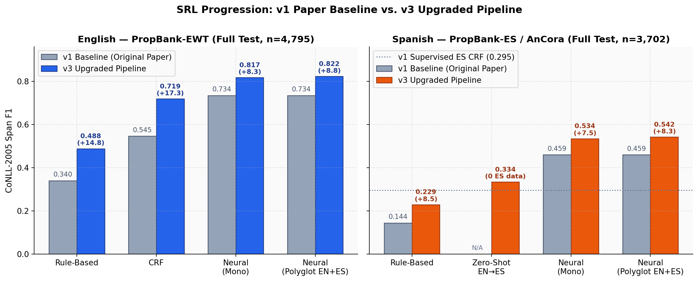
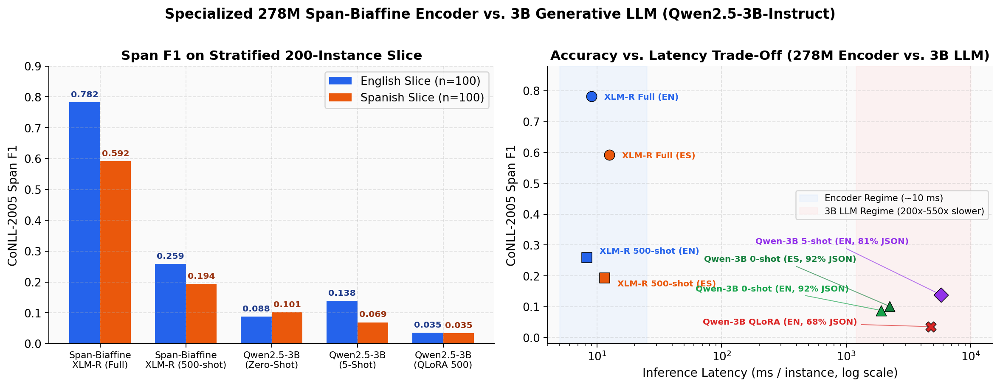
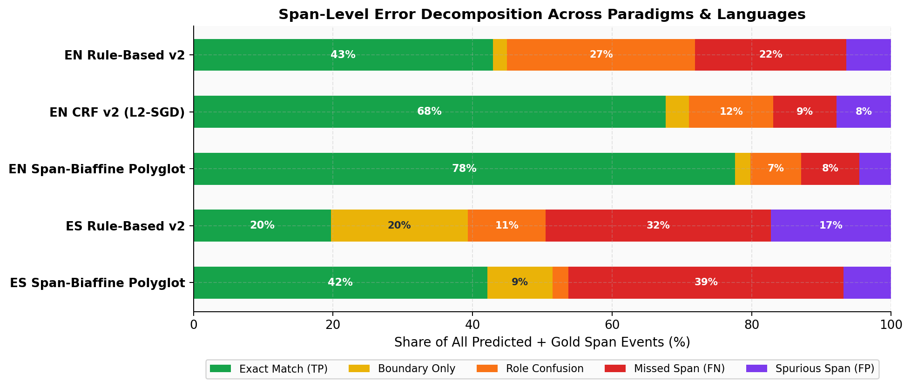

# Semantic Role Labeling (SRL): From Rule-Based & CRF Baselines to Multi-Predicate Span-Biaffine & LLM Benchmarking

Cross-lingual Semantic Role Labeling (PropBank-EWT English & PropBank-ES / AnCora Spanish) spanning **four paradigms**: **Dependency Rule-Based**, **Syntactic Linear-Chain CRF**, **Multi-Predicate Span-Biaffine Transformer (Monolingual, Zero-Shot, & Polyglot)**, and **4-bit Generative LLMs (Zero-Shot, 5-Shot Pydantic JSON, & QLoRA)**.

> **Research Evolution Note (`v1` Paper → `v3` Upgraded Pipeline):**  
> This repository preserves the original course research paper ([`Semantic Role Labeling.pdf`](Semantic%20Role%20Labeling.pdf), **v1**) alongside a full engineering audit and architectural upgrade (**v3**). Every v1 bottleneck diagnosed through span-level error analysis was systematically fixed, verified with unit tests, and benchmarked on the exact same CoNLL-2005 span-level protocol and test splits.

[](https://colab.research.google.com/github/yavuzselimuyaner/Semantic-Role-Labeling/blob/main/srl_v3_research_colab.ipynb)

---

## Executive Summary of Results (v1 vs. v3)

All models are evaluated using **exact CoNLL-2005 span-level Precision, Recall, and F1** (excluding predicate tag `B-V` since the predicate is given as input). Full summary CSV: [`SRL_data/results_v3_summary.csv`](SRL_data/results_v3_summary.csv).

### 1. Full Test Set Progression (PropBank-EWT `n=4,795` · PropBank-ES `n=3,702`)

| Paradigm / Model | Dataset | v1 Paper F1 | **v3 Precision** | **v3 Recall** | **v3 F1** | **Gain (ΔF1)** | Latency (`ms/inst`) |
| :--- | :--- | :---: | :---: | :---: | :---: | :---: | :---: |
| **Rule-Based** (`en_core_web_trf`) | PropBank-EWT (EN) | 0.3397 | 0.5340 | 0.4488 | **0.4877** | **+14.80** | — |
| **Linear-Chain CRF** (`L2-SGD`, LCA paths) | PropBank-EWT (EN) | 0.5453 | 0.7236 | 0.7135 | **0.7185** | **+17.32** | — |
| **Span-Biaffine XLM-R** (Monolingual EN) | PropBank-EWT (EN) | 0.7343 *(BERT)* | 0.8331 | 0.8011 | **0.8168** | **+8.25** | **2.4 ms** |
| **Span-Biaffine XLM-R (Polyglot EN+ES)** | PropBank-EWT (EN) | 0.7343 *(BERT)* | **0.8390** | **0.8057** | **0.8220** | **+8.77** | **2.1 ms** |
| **Rule-Based** (`es_dep_news_trf`) | PropBank-ES (ES) | 0.1438 | 0.2504 | 0.2101 | **0.2285** | **+8.47** | — |
| **Zero-Shot Transfer (EN → ES, 0 ES labels)** | PropBank-ES (ES) | — | 0.3694 | 0.3039 | **0.3335** | *Beats v1 ES CRF (0.295)* | **5.6 ms** |
| **Span-Biaffine XLM-R** (Monolingual ES) | PropBank-ES (ES) | 0.4594 *(mBERT)* | 0.6711 | 0.4434 | **0.5340** | **+7.46** | **5.0 ms** |
| **Span-Biaffine XLM-R (Polyglot EN+ES)** | PropBank-ES (ES) | 0.4594 *(mBERT)* | **0.6853** | **0.4481** | **0.5419** | **+8.25** | **4.9 ms** |



### 2. Specialized Encoder (278M) vs. Generative LLM (3B) Benchmark

Evaluated on an identical **200-instance stratified slice** (100 English + 100 Spanish covering short, medium, and long sentences) on a single Tesla T4 GPU. Generative outputs are parsed via strict **Pydantic JSON validation** (`ArgumentSpan` / `SRLPrediction`) with deterministic text-to-token alignment fallback.

| Model | Params | Training Budget | EN Slice F1 | ES Slice F1 | JSON Valid % | Latency (`ms/inst`) |
| :--- | :---: | :---: | :---: | :---: | :---: | :---: |
| **Span-Biaffine XLM-R (Polyglot)** | **278M** | Full (EN+ES) | **0.7824** | **0.5916** | 100% *(native)* | **9.0 – 12.6 ms** |
| **Span-Biaffine XLM-R (Low-Resource)** | **278M** | 500 (250 EN + 250 ES) | **0.2586** | **0.1935** | 100% *(native)* | **8.3 – 11.5 ms** |
| **Qwen2.5-3B-Instruct** (4-bit NF4, Zero-Shot) | 3B | 0 | 0.0878 | 0.1013 | 92.0% | 1,909 – 2,230 ms |
| **Qwen2.5-3B-Instruct** (4-bit NF4, 5-Shot) | 3B | 5 | 0.1383 | 0.0694 | 81.0% – 85.0% | 5,782 – 6,234 ms |
| **Qwen2.5-3B-Instruct** (4-bit QLoRA, 2 ep) | 3B | 500 (250 EN + 250 ES) | 0.0354 | 0.0347 | 68.0% – 76.0% | 4,693 – 4,787 ms |



---

## Detailed Audit: What Changed from v1 (`Semantic Role Labeling.pdf`) to v3

### 1. Rule-Based SRL Fixes (`0.340 → 0.488` EN · `0.144 → 0.229` ES)
Diagnostic inspection of v1 per-role scores exposed four structural bugs in [`srl_crf_bert_comparison.ipynb`](srl_crf_bert_comparison.ipynb):
* **Missing `ARGM-` / `AM-` Prefix Bug:** The preposition lookup returned bare `'LOC'`, `'TMP'`, and `'ADV'` instead of `'ARGM-LOC'` / `'AM-LOC'`, causing every prepositional adjunct to score **0.0000 F1** (simultaneously an FP and FN). Fixing this recovered `ARGM-TMP` (`0.000 → 0.528`), `ARGM-LOC` (`0.000 → 0.325`), `ARGM-PRP` (`0.000 → 0.286`), and `ARGM-ADV` (`0.000 → 0.279`).
* **Spanish UD `obl → case` Structure:** In Universal Dependencies Spanish (`es_dep_news_trf`), prepositions (`case`) are children of the oblique head (`obl`), not children of the predicate verb. Traversing `obl → case` unlocked oblique arguments across Spanish.
* **Missing High-Frequency Roles & `advmod` Over-Prediction:** Added modal auxiliary detection (`aux` + `MD` → `ARGM-MOD`, jumping `0.000 → 0.901 F1` at `95.9%` precision across 441 test instances), replaced the blanket `advmod → ARGM-MNR` heuristic (4.9% precision in v1) with lexicalized temporal/locative/extent/discourse/negation/manner routing, added `advcl`/`npadvmod` rules, `xcomp`/`conj` shared-subject inheritance, and span boundary punctuation trimming.

### 2. Syntactic CRF Fixes (`0.545 → 0.719` EN, +17.32 F1)
* **Eliminated Token Drift:** Replaced `" ".join(words)` re-tokenization (which misaligned contractions, URLs, and punctuation in English Web Treebank) with pre-tokenized `Doc(nlp.vocab, words=w)` for guaranteed 1-to-1 alignment.
* **True Syntactic SRL Features (`src/srl/crf_model.py`):** Replaced the broken upward-only path helper (which returned `"none"` for direct predicate children) with **Lowest Common Ancestor (LCA) directional paths** (`^nsubjvxcomp`), `top_arg_dep` (shared direct-child dependency label across an entire argument subtree), governing preposition extraction, subtree start/end boundary cues (`is_sub_start`/`is_sub_end`), and English/Spanish passive voice indicators.
* **Runtime & Convergence Engineering:** Enabled `spacy.prefer_gpu()` + **sentence deduplication across predicates** (cutting 40,424 EN parse calls to ~12,500 unique sentences in **59.6 seconds** on T4) and switched from single-core dense `L-BFGS` (`min_freq=0`, `all_possible_transitions=True`, 1.4 hours) to sparse valid-transition `L2-SGD` (`min_freq=5`, `all_possible_transitions=False`). This closed the ~10-point gap to Pradhan et al. (0.66–0.77) noted in Section IV-D of the v1 paper.

### 3. Architectural Shift: From BIO Token Tagging to Multi-Predicate Span-Biaffine (`src/srl/span_biaffine.py`)
In v1, `bert-base-cased` (EN `0.734`) and `bert-base-multilingual-cased` (ES `0.459`) treated SRL as independent predicate-duplicated BIO tagging with greedy `argmax` decoding. That design had four structural weaknesses: mid-span BIO fragmentation (causing EN Precision `0.697` to lag Recall `0.776` by 8 points), inability to enforce global core-role uniqueness, redundant `3×` encoder passes on the same sentence, and isolated EN/ES label namespaces.

In v3, we implemented a **Multi-Predicate Span-Biaffine SRL** architecture (`xlm-roberta-base`, FP16):
1. **Unified Cross-Lingual Schema (`src/srl/schema.py`):** Harmonizes Spanish AnCora (`A0..A4`, `AM-*`) and English PropBank (`ARG0..ARG4`, `ARGM-*`) into a single role inventory, enabling **Zero-Shot EN→ES** and **Polyglot EN+ES Joint Training**.
2. **Encode Once per Unique Sentence:** Groups all predicates sharing a sentence into one forward pass (`40,424 → ~12,500` EN sentences, `31,471 → ~14,300` ES sentences).
3. **Span Pruning + Vectorized Biaffine Scoring:** Enumerates candidate spans `(s, e)` represented as `[h_s ; h_e ; h_e - h_s ; width_emb]`, trains a unary pruner with auxiliary BCE loss, and scores `(predicate, span, role)` triples via a single `torch.einsum("pd,drq,kq->pkr", ...)` Biaffine tensor.
4. **Global Constraint Decoding:** Enforces non-overlapping spans and **at most one core role (`ARG0..ARG5`) per predicate**, yielding **`0` illegal BIO transitions** across every neural experiment and `2.1–4.9 ms/instance` throughput.
5. **Engineering Hardening:** Fixed Linux `DataLoader(num_workers=2)` + HuggingFace Rust `tokenizers` `fork()` deadlock by pre-tokenizing unique sentences once with `TOKENIZERS_PARALLELISM=false`, and added a pure-PyTorch BIO-constrained Linear-Chain CRF module (`src/srl/decoding.py`) + predicate-conditioned BIO ablation (`src/srl/transformer_model.py`).

---

## Error Analysis & Honest Research Findings



Automated span-level error decomposition (`src/srl/metrics.py`) surfaced three concrete insights:

1. **Polyglot Transfer Works in Both Directions:**  
   Joint EN+ES training beat monolingual `xlm-roberta-base` on **both** English (`0.8168 → 0.8220`) and Spanish (`0.5340 → 0.5419`). Remarkably, **Zero-Shot EN→ES (`0.3335`)** outperformed the supervised v1 Spanish CRF (`0.2952`) with zero Spanish labels.
2. **Root Cause of Spanish Recall Ceiling (`P=0.685` vs. `R=0.448`):**  
   On `span_biaffine_polyglot_es`, pure role confusion is remarkably low (**only `197` errors** vs. `703` on EN), whereas **`missed_fn = 3,398`** and **`boundary_only = 806`** dominate! Spanish AnCora newswire sentences contain long clausal arguments (`A1`/`A2`) that frequently exceed the `max_width = 30` span enumeration cap and aggressive pruning ratio. Raising `max_width` to `60+` (or combining with a BIO-CRF decoder for long clauses) is the single highest-leverage next step for Spanish.
3. **Why Specialized Encoders Still Dominate 3B Generative LLMs on Strict Span Extraction:**  
   * **Structured Syntax ≠ Span Grounding:** Zero-shot `Qwen2.5-3B-Instruct` produced valid Pydantic JSON **92% of the time**, yet achieved only `0.088–0.101` exact CoNLL-2005 F1 (`0.138` 5-shot EN) while running **200×–550× slower** (`1,909–6,234 ms/inst` vs. `9.0–12.6 ms/inst`). Small generative models struggle with strict 0-based token-index grounding and PropBank boundary conventions.
   * **QLoRA Failure Mode Under Tiny Budgets:** 500-shot QLoRA (`2 epochs`, effective `batch_size=16` → only ~62 gradient steps at `lr=2e-4` without warmup and `max_length=512` truncation) degraded JSON compliance (`92% → 68%`) and dropped F1 to `0.035`. Under the exact same 500-example budget, the 278M Span-Biaffine encoder still outperformed both 0-shot, 5-shot, and QLoRA 3B LLM (`0.259` EN / `0.194` ES) at `~500×` lower latency.

---

## Repository Structure

```text
Semantic-Role-Labeling/
├── Semantic Role Labeling.pdf          # Original v1 IEEE-format baseline study
├── srl_v3_research_colab.ipynb         # Resume-safe v3 Colab T4 benchmark (Span-Biaffine + Polyglot + Qwen2.5 LLM)
├── srl_v2_colab.ipynb                  # v2 ablation notebook (Predicate-Conditioned BIO + Linear-Chain CRF)
├── srl_crf_bert_comparison.ipynb       # Original v1 notebook (preserved for historical reproducibility)
├── src/srl/
│   ├── data.py                         # Dataset loader & span/length diagnostics
│   ├── schema.py                       # Unified EN+ES PropBank role mapping & multi-predicate sentence grouper
│   ├── metrics.py                      # CoNLL-2005 exact span P/R/F1 & automated error decomposition
│   ├── rule_based.py                   # Bug-fixed dependency Rule-Based SRL (EN ClearNLP + ES UD obl->case)
│   ├── crf_model.py                    # 1-to-1 aligned spaCy parser (deduplicated) + LCA-path L2-SGD CRF
│   ├── decoding.py                     # Pure-PyTorch BIO-constrained Linear-Chain CRF & Viterbi decoder
│   ├── transformer_model.py            # Predicate-Conditioned Transformer + CRF (BIO paradigm)
│   ├── span_biaffine.py                # Multi-Predicate Span-Biaffine SRL + global unique-core decoding
│   └── llm_srl.py                      # 4-bit Qwen2.5 Zero/Few-Shot (Pydantic JSON) & QLoRA fine-tuning
├── scripts/
│   ├── run_benchmark.py                # Modular CLI benchmark runner
│   └── generate_figures.py             # Generates all README charts from verified CSV/JSON results
├── tests/
│   ├── test_srl.py                     # 6 unit/integration tests for v2 modules
│   └── test_srl_v3.py                  # 4 unit/integration tests for v3 Span-Biaffine, schema & LLM parser
├── figures/                            # Generated comparison & error-analysis charts
├── SRL_data/
│   ├── results_rule_crf.csv            # Original v1 baseline CSV
│   └── results_v3_summary.csv          # Verified v3 master benchmark CSV
└── requirements-srl.txt
```

---

## Quickstart & Verification

```bash
# Install dependencies
pip install -r requirements-srl.txt

# Run all 10 unit & integration tests locally on CPU (no GPU or dataset download required)
python tests/test_srl.py
python tests/test_srl_v3.py

# Regenerate all figures from verified results
python scripts/generate_figures.py
```

To reproduce the full GPU experiments (Rule-Based v2, CRF v2, Multi-Predicate Span-Biaffine EN/ES/Zero-Shot/Polyglot, and 4-bit `Qwen2.5-3B-Instruct` Zero/Few-Shot & QLoRA), open [`srl_v3_research_colab.ipynb`](srl_v3_research_colab.ipynb) on Google Colab with a T4 GPU.

---

## Author

**Yavuz Selim Uyaner**  
Department of Computer Engineering, Ankara University  
[GitHub](https://github.com/yavuzselimuyaner) · [Portfolio](https://yavuzselimuyaner.github.io) · [LinkedIn](https://www.linkedin.com/in/yavuz-selim-uyaner-644059323/) · yavuzselimuyaner@gmail.com
